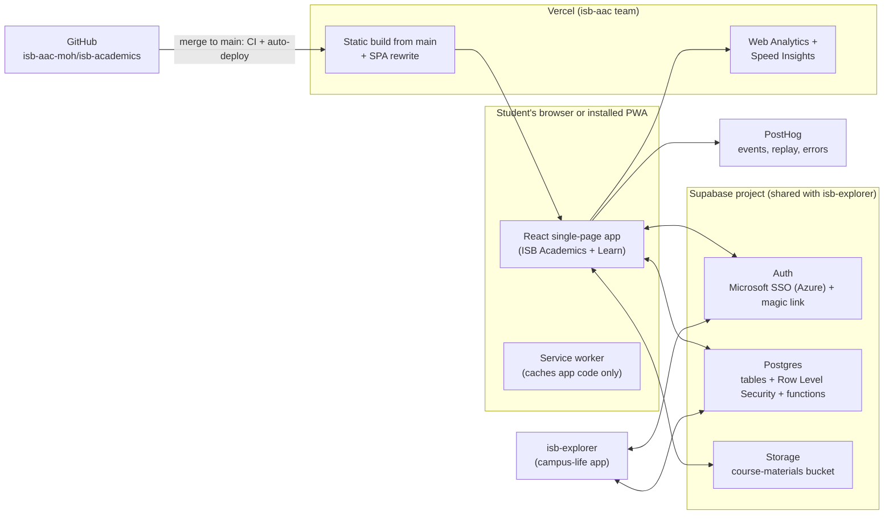

# Architecture

How ISB Academics is built and deployed, end to end. Written so someone who didn't build it can follow it.

## The system at a glance



There is no custom backend server. The browser app talks directly to Supabase, and **Row Level Security (RLS)** policies in Postgres decide what each signed-in user may read or write. Anything sensitive that students need in aggregate (Bidding Pulse statistics, Learn admin statistics) goes through Postgres functions that return only the safe summary.

## The big decision: shared backend, separate app

`isb-academics` is a separate codebase and a separate Vercel deployment from `isb-explorer`, the campus-life app, but both use **one Supabase project**.

- Different products shouldn't share one commit history. Separate repos are easier to hand off and to scope access for.
- A second Supabase project would have meant a second Azure app registration and a second login for the same students, for no benefit.

So: one Supabase project, one `users` table, one Microsoft SSO setup, two frontends. `src/lib/supabase.ts` uses `storageKey: "pulse-isb-auth"`, the same key isb-explorer uses, which is what lets one login work for both apps in the same browser.

Consequences to keep in mind:

- `users` is owned by isb-explorer. This app reads it and relies on isb-explorer's onboarding to create the row.
- Any migration here runs against a database another app depends on. Check before altering shared tables.
- Local development uses the same production database.

## Repos, hosting and services

| | Value |
|---|---|
| GitHub | `isb-aac-moh/isb-academics` (private; moved from `jain-eshan/isb-academics`, which redirects) |
| Vercel project | `isb-academics`, team scope `isb-aac` |
| Live URL | https://isb-academics.vercel.app |
| Supabase project | ref `ujnrgvmbahbepdnahtle`, shared with isb-explorer (`pulse-isb`) |
| Analytics | PostHog (US cloud), Vercel Web Analytics, Vercel Speed Insights |

## Frontend stack

| Piece | Choice | Why |
|---|---|---|
| Framework | React 19 + TypeScript | Familiar from earlier projects; strong typing across a data-heavy UI |
| Build | Vite 8 | Fast dev server and build |
| Routing | React Router 7 (declarative `<Routes>`) | Every state gets a real URL |
| Styling | Tailwind CSS v4 + inline styles from `src/lib/theme.ts`; Learn uses Tailwind tokens | See [DESIGN.md](DESIGN.md) |
| Data | `@supabase/supabase-js` called from small custom hooks | No global state or caching library needed at this data size |
| Icons | `lucide-react` | |
| Maths | KaTeX, loaded only in Learn | |
| PWA | `vite-plugin-pwa` | Home-screen install on iOS and Android |
| Analytics | `posthog-js` + `@posthog/react`, `@vercel/analytics`, `@vercel/speed-insights` | |

No component library, no Redux or Zustand, no React Query. That's deliberate: the data volumes are hundreds of rows, and "fetch, then refetch after you write" is easy to follow for someone picking this up cold.

## Source layout

```
src/
  main.tsx              Entry: PostHog init, router, Vercel analytics
  App.tsx               Auth gate + route table (every page lazy-loaded)
  index.css             Tailwind import + Learn's design tokens
  components/           Shell and shared UI
    Layout.tsx            Sidebar + content + BottomNav + PopupManager
    Sidebar.tsx           Desktop rail / mobile drawer
    BottomNav.tsx         Mobile tab bar
    RequireAdmin.tsx      Route guard
    PopupManager.tsx      Admin-driven dialogs
    CourseDetailModal.tsx Course side panel (resources + faculty)
    FacultySection.tsx    Faculty cards and rating badge
    ConcentrationChoice.tsx, Dropdown.tsx
  pages/                One file per top-level page
    CreditTracker, BiddingPlanner, PulseCheck, CourseResources,
    TermDossier, TermFourDossier, TermFourBiddingQA, NoticeBoard,
    AdminPage, Login
    planner/              The five planner steps + TermGlance
  hooks/                One hook per data source (useCourses, useBidPlan, ...)
  lib/                  Pure logic and constants
    supabase.ts           The single Supabase client
    theme.ts, options.ts  Design tokens, fixed option lists
    creditProgress.ts     Credit, reserve and budget maths
    termCalendar.ts       Co'27 term dates
    workloadRadar.ts      avg() helper (the radar and workload score are no longer shown)
    relevance.ts          Soft relevance tags
    lazyWithReload.ts     Stale-chunk recovery
    devFixtures.ts        Fake Pulse data for local dev
  types/index.ts        Shared TypeScript types
  learn/                The Learn section (see LEARN.md)
public/                 Static files: icons, Term 4 HTML pages, revision guides, Term 4 outline PDFs
supabase/migrations/    Every database change, timestamped
supabase/*.py           Learn content generators
scripts/                madm_revision.py (MADM revision guide generator)
context-docs/           ISB source documents the rules are based on
```

## Auth flow

1. `useAuth` (`src/hooks/useAuth.ts`) subscribes to Supabase's auth state. Sign-in is `signInWithOAuth` with the Azure provider (Microsoft SSO) or `signInWithOtp` (email magic link).
2. On a session, the email must end in `@isb.edu`. Otherwise the user is signed out immediately. This is the only domain gate.
3. The matching `users` row is loaded. `is_admin` on that row is the only permission flag in the app. If there is no row, `notProvisioned` is set and Login shows "Account not set up yet".
4. The user is identified to PostHog.
5. **Redirect URLs are a Supabase dashboard setting**, not code: Authentication → URL Configuration → Redirect URLs. Both `http://localhost:5174/**` and `https://isb-academics.vercel.app/**` must be listed. If they aren't, Supabase falls back to the project's Site URL, so login lands on the wrong address. The Site URL was isb-explorer's until Nov 2026, when it moved to this app. This happened twice during development. It's also why the dev server port is pinned to 5174 with `strictPort`.

While there is no user, `App.tsx` renders `<Login />` for any path without changing the URL. After sign-in the same URL renders the right page, so bookmarked deep links work with no redirect-back logic.

## Routes

```
/                          → /tracker
/tracker                   Credit Tracker (home)
/planner                   → /planner/background
/planner/:step             Bidding Planner; step ∈ background, goals, plan, glance, budget
/pulse-check               Bidding Pulse
/resources                 Course Resources (?q, term, kind, type, course, view)
/dossier/:term             Term Dossier; term as a slug, e.g. term-5
/term5                     → /dossier/term-5
/term4                     Term 4 Dossier (iframe of public/term4-dossier.html)
/term4-bidding-qa          Term 4 Bidding Q&A (iframe of public/term4-bidding-qa.html)
/learn/*                   Learn section (its own nested routes, see LEARN.md)
/notices                   Notice Board               [admin only]
/admin                     → /admin/overview          [admin only]
/admin/:tab                Admin; tab ∈ overview, courses, resources,
                           notifications, nav-links, popups   [admin only]
*                          → /
```

How state maps to URLs is a deliberate choice:

- **Path segments for distinct screens**: planner steps and admin tabs.
- **A path segment for one artefact per term**: `/dossier/term-5` is shared as a link, and a new term needs data, not a route.
- **Query parameters for filters**: Course Resources was first built with a page per term and course, then rebuilt as one filterable page because that's what was asked for. Query parameters keep it shareable and refresh-safe.

**Route guard:** `RequireAdmin` wraps `/notices` and `/admin/*` and redirects non-admins to `/tracker`. It is enforced in `App.tsx`, independent of what the sidebar shows, so typing the URL doesn't get around it. Learn has its own `RequireAdmin` for `/learn/admin`. The real protection for data is still RLS; the route guards just keep people out of screens they can't use.

## Data flow

Every kind of server data has one small hook in `src/hooks/` that owns a `useState`, fetches in a `useEffect`, and exposes a `reload()` or save functions. Components call the save function and then reload or update local state.

| Hook | Reads / writes |
|---|---|
| `useAuth` | Supabase Auth, `users` |
| `useCourses` | `courses` (active only unless admin asks for all), `gating_core_courses` |
| `useAcademicProfile` | `student_academic_profiles` (optimistic save with rollback) |
| `useBidPlan` | `bid_plan_entries`; also holds bidding constants (4,500 points, 100 minimum, 100 reserve per credit, 18 credits) |
| `useActualEnrollments` | `actual_enrollments` |
| `useAppSettings` | `app_settings` (live bidding terms, term credit limits) |
| `useCourseGradingProfiles` | `course_grading_profiles` |
| `useFaculty` | `faculty`, `course_faculty`, `faculty_ratings` |
| `usePulseCheck` | `pulse_check_submissions` + the two Pulse functions |
| `useResources` | `resources` |
| `useNotifications` | `notifications` |
| `useNavLinks` | `nav_links` |
| `useDashboardPopups` | `dashboard_popups` |

Learn keeps its database code in `src/learn/lib/db.ts` instead of hooks, inherited from the original app.

Settings load once when a page mounts. Nothing subscribes to live updates, so an admin change shows up on the student's next page load.

Business rules live in plain functions in `src/lib/` (credit maths, relevance tags), separate from the UI, so they can be read and checked on their own.

## Performance

- **Every page is code-split.** Only the shell (Layout, Sidebar) and Login are in the first download; other pages load while the auth check is still running, so it costs no extra wait. Commit `58723ba` cut the first load by about a quarter this way.
- **Vendor code is pinned into two long-lived files**, `react-vendor` and `supabase-vendor` (`vite.config.ts`). Without this, a one-line app change could invalidate 450 kB of cached library code.
- **Stale chunks after a deploy.** A tab left open across a deploy asks for page files that no longer exist. `lazyWithReload` catches the failed import, reloads the page once (tracked in sessionStorage so it can't loop), and rethrows if it fails again.
- **KaTeX and the Learn widgets** load only when needed.
- `index.html` preconnects to Supabase and loads Google Fonts without blocking the first paint.
- The service worker caches app code and icons. Supabase requests are never cached.

## Hosting and deploys

**`vercel.json`:**

```json
{ "rewrites": [{ "source": "/((?!.*\\.[a-zA-Z0-9]+$).*)", "destination": "/index.html" }] }
```

Any path without a file extension is served `index.html` so React Router can handle it. Without this, refreshing `/admin/courses` in production would 404, even though it works locally (Vite's dev server does the same rewrite automatically, which hides the bug). Paths with an extension, like `/term4-dossier.html` or `/icon-192.png`, are served as real files.

**Normal path:** open a PR, CI runs, Vercel posts a preview deployment, merge to `main`, and Vercel builds and deploys to production within about a minute. There is no staging gate between `main` and production.

**CI** (`.github/workflows/ci.yml`) runs on every PR and push to `main`: Node 24, `npm ci`, `npm run lint` (errors fail; React Compiler rules are warnings on purpose, see `eslint.config.js`), `npm run build` (includes `tsc -b` typecheck).

**Deploying by hand** is only needed if an automatic deploy fails. Two gotchas, both hit during the PWA release on 2026-09-10:

- **Hobby-plan concurrent build limit.** If another deploy is building, a new one can come back "Deployment was blocked", and `vercel redeploy` refuses to retry it. Run `vercel --prod --yes --scope isb-aac` from a checkout that matches `origin/main` exactly (`git diff HEAD origin/main --stat` prints nothing).
- **A fresh git worktree has no `.vercel/project.json`.** Running `vercel --prod` there creates and links a new, separate Vercel project named after the folder. Copy `.vercel/project.json` from the main checkout first (project `isb-academics`).

**Deploys blocked by commit author.** On Vercel's Hobby plan, a commit whose Git author isn't an account with deploy permission is silently not built. This has happened to contributor commits and to merge commits made from GitHub under a different account (for example PR #35's merge). The fix each time was an empty commit authored by the permitted account: `git commit --allow-empty -m "chore: retrigger production deploy"` and push. If a merge doesn't show up in production, check this first.

## Database changes

- Every change is a timestamped SQL file in `supabase/migrations/`, applied with the **Supabase CLI** (`supabase db push`, with the CLI linked via `supabase link --project-ref ujnrgvmbahbepdnahtle`).
- **Never apply changes in the dashboard's SQL editor.** The CLI's migration history and the repo drift apart, and later pushes break.
- There is no staging database, so a migration is live the moment it's pushed. Write migrations to be safe to rerun (`if not exists`, `on conflict`).
- For every new `security definer` function: revoke execute from both `public` **and** `anon`. On this project Supabase grants `anon` execute on new functions by default, separately from `public`. This was found live on the first Pulse function.
- Seed data for courses, grading profiles, faculty and Learn content also ships as migrations, so the repo records where each value came from.

Schema reference: [DATA_MODEL.md](DATA_MODEL.md).

## Analytics and monitoring

- **PostHog** is set up in `src/main.tsx` with `VITE_PUBLIC_POSTHOG_PROJECT_TOKEN`. In development a missing token throws on purpose, so events are never silently lost; in production a missing token just skips analytics. `PostHogErrorBoundary` wraps the app and reports render crashes. Session replay and error tracking are on in the PostHog project. The event list is in [PRODUCT.md](PRODUCT.md#what-we-measure). `posthog-self-driving-report.md` at the repo root records the PostHog project setup.
- **Vercel Web Analytics and Speed Insights** are mounted in `main.tsx` for traffic and Core Web Vitals.
- There is no server-side logging because there is no server. Database errors show in the Supabase dashboard's logs.

## Environment variables

| Variable | Read in | Required |
|---|---|---|
| `VITE_SUPABASE_URL` | `src/lib/supabase.ts`, `index.html` (preconnect) | Yes |
| `VITE_SUPABASE_ANON_KEY` | `src/lib/supabase.ts` | Yes |
| `VITE_PUBLIC_POSTHOG_PROJECT_TOKEN` | `src/main.tsx` | Yes in dev (throws), optional in production |
| `VITE_PUBLIC_POSTHOG_HOST` | `src/main.tsx` | No, defaults to US cloud |

All are `VITE_` variables, which means they are bundled into the browser code and are public. That's expected: the Supabase anon key is designed to be public, and RLS is what protects data. Never put a Supabase service-role key in a `VITE_` variable.

Some local `.env.local` files also contain Azure and Google Maps keys copied from isb-explorer. Nothing in this app reads them.

## Local development tips

- `npm run dev` on port 5174. `.claude/launch.json` defines the same server for Claude Code's preview browser.
- **Dev mode shows fake Bidding Pulse statistics** (`src/lib/devFixtures.ts`) so testing doesn't pollute the real cohort numbers in the shared database. Real Pulse data can only be checked on production.
- Anything else you save locally (bid plans, grades, admin edits) writes to production data. Use your own account and clean up.
